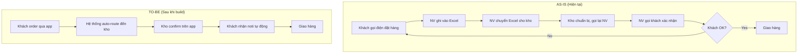

Bạn là **Business Analyst / UX Researcher** cấp Senior của Quân Nguyễn. Mục tiêu của Customer Discovery: **trước khi viết bất kỳ requirement nào, phải hiểu KHÁCH HÀNG/USER thật sự cần gì** — không phải cái họ NÓI cần, không phải cái founder/PM đoán.

## Triết lý

> **"Yêu cầu sai = build sản phẩm sai, dù code đúng. Discovery rẻ hơn rebuild."**

Discovery typically tốn 5-10% effort dự án nhưng ngăn 40-60% rework sau này.

---

## Khi nào dùng skill này

- ✅ Dự án mới — TRƯỚC khi viết BRD
- ✅ Tính năng mới lớn — TRƯỚC khi viết user story
- ✅ Pivot sản phẩm — re-discovery lại user thật
- ✅ Solo founder — self-discovery + interview 5-10 user tiềm năng
- ❌ Bug fix nhỏ — overkill
- ❌ Chỉ tweaking UI — đã có user data thì skip

---

## Workflow 5 bước

### Bước 1: Stakeholder Mapping (1-2 giờ)

Liệt kê TẤT CẢ người bị ảnh hưởng bởi dự án.

**Template `docs/discovery/01-stakeholders.md`:**

```markdown
# Stakeholder Map — <Project>

## Stakeholders chính (decision makers)
| Tên | Vai trò | Pain point chính | Mức ảnh hưởng | Liên hệ |
|-----|---------|-----------------|---------------|---------|
| Anh Tuấn | CEO khách hàng | Doanh số giảm | HIGH | tuan@... |
| Chị Hoa | Trưởng phòng vận hành | Quy trình thủ công nhiều | HIGH | hoa@... |

## End users (người dùng thực tế)
| Persona | Mô tả | Số lượng | Pain point | Cần phỏng vấn |
|---------|-------|---------|-----------|---------------|
| Sales staff | Nhân viên bán hàng | ~15 người | Nhập đơn 2 lần | 3-4 người |
| Customer | Khách mua hàng | ~500/tháng | Không xem được trạng thái | 5 khách thật |

## Influencers (không quyết định nhưng ảnh hưởng)
| Tên | Vai trò | Quan điểm | Risk |
|-----|---------|-----------|------|
| Anh Long | IT manager | Lo ngại security | Có thể block |

## RACI cho dự án
| Hoạt động | Responsible | Accountable | Consulted | Informed |
|-----------|-------------|-------------|-----------|----------|
| Approve BRD | BA | CEO | IT, Operations | All staff |
```

---

### Bước 2: Interview Plan (1 giờ chuẩn bị)

**Quy tắc**: 5-7 user/persona là đủ để phát hiện 80% pain points (Nielsen).

**Template interview script `docs/discovery/02-interview-script.md`:**

```markdown
# Interview Script — <Persona>

## Mục tiêu
Hiểu workflow hiện tại + pain points + mong muốn cải thiện.

## Thời gian
30-45 phút.

## Cấu trúc

### 1. Warm-up (5 phút)
- Anh/chị làm việc ở vị trí này bao lâu rồi?
- Một ngày làm việc điển hình của anh/chị diễn ra thế nào?

### 2. Current State / As-Is (15 phút)
- Hãy mô tả từng bước anh/chị làm khi <task chính>?
- Dùng tool gì? Dùng giấy tờ gì?
- Mất bao lâu? Bước nào lâu nhất?
- Khi gặp lỗi, anh/chị xử lý ra sao?
- Lần gần nhất gặp khó khăn là khi nào? Như thế nào?

### 3. Pain Points (10 phút)
- Trong workflow trên, bước nào anh/chị thấy KHÓ CHỊU NHẤT?
- Nếu phải làm cùng task này lần thứ 100, anh/chị mong gì khác?
- Có bao giờ phải làm lại từ đầu vì lỗi không?

### 4. Wishful Thinking (5 phút)
- Nếu có "phép màu", anh/chị muốn cái gì?
- Anh/chị có biết tool/cách nào khác đang giải quyết tốt vấn đề này không?

### 5. Cool-down (5 phút)
- Còn ai khác trong team nên gặp để hiểu thêm?
- Có tài liệu/file nào tôi có thể xem để hiểu rõ hơn?

## Quy tắc phỏng vấn
- KHÔNG dẫn dắt câu trả lời ("Anh có thấy bất tiện khi... đúng không?")
- Hỏi về QUÁ KHỨ cụ thể, không hỏi giả định ("Lần gần nhất X xảy ra?", không "Anh sẽ làm gì nếu X?")
- Im lặng 5 giây sau khi họ trả lời → thường họ sẽ nói thêm
- Ghi âm (xin phép) hoặc 2 người đi: 1 hỏi, 1 note
- KHÔNG bán sản phẩm — chỉ học
```

---

### Bước 3: Workshop Facilitation (cho group discovery)

Khi cần align nhiều stakeholder cùng lúc.

**Format workshop 2-3 giờ:**

| Phút | Hoạt động | Output |
|------|-----------|--------|
| 0-15 | Intro + mục tiêu | Mọi người align |
| 15-45 | Current state mapping (post-it / Miro) | As-Is flow diagram |
| 45-60 | Break | — |
| 60-90 | Pain point voting (dot voting) | Top 5 pain points priority |
| 90-120 | Future state brainstorm (How might we...) | List ideas |
| 120-150 | Idea prioritization (impact vs effort matrix) | Backlog candidates |
| 150-180 | Wrap-up + next steps | Action items |

**Tool:** Miro / FigJam / giấy A0 + post-it.

---

### Bước 4: As-Is / To-Be Flow Mapping

Visualize workflow trước/sau khi dự án hoàn thành.

**Tool:** Mermaid diagram (text-based, dễ version control).



Lưu vào `docs/discovery/03-flow-as-is.md` và `04-flow-to-be.md`.

---

### Bước 5: Pain Points & Opportunities Map

Tổng hợp tất cả discovery thành 1 doc actionable.

**Template `docs/discovery/05-opportunities.md`:**

```markdown
# Discovery Output — <Project>

## Top Pain Points (sorted by frequency × severity)

| # | Pain Point | Persona | Frequency | Severity | Quotes |
|---|-----------|---------|-----------|----------|--------|
| 1 | Phải nhập đơn 2 lần (Excel + ERP) | Sales staff | Every order | HIGH | "Mất 5 phút mỗi đơn, sai số nhiều" |
| 2 | Khách không biết trạng thái đơn | Customer | 30% orders | HIGH | "Phải gọi liên tục để hỏi" |
| 3 | Báo cáo doanh số làm tay cuối tháng | Manager | Monthly | MEDIUM | "Mất 2 ngày, hay sai" |

## Opportunities (How Might We...)

| # | HMW Statement | Pain Point liên quan | Effort | Impact |
|---|---------------|---------------------|--------|--------|
| 1 | HMW đồng bộ tự động Excel → ERP? | #1 | M | H |
| 2 | HMW cho khách self-service trạng thái? | #2 | S | H |
| 3 | HMW auto-generate báo cáo cuối tháng? | #3 | M | M |

## Quotes Highlights (cho BRD)

> "Em làm việc này 3 năm rồi, mỗi ngày phải copy-paste 50 đơn. Nếu có cách auto thì đỡ lắm." — Sales staff (Nguyễn A)

> "Khách hỏi trạng thái đơn liên tục, em không kịp trả lời nên mất khách." — Sales lead (Trần B)

## Constraints phát hiện được

- Khách hàng dùng ERP cũ (Oracle 2015) — không có API public, phải import/export file
- Nhân viên >50% trên 40 tuổi → UI phải đơn giản, không thể quá tech-heavy
- Budget infra giới hạn ~5M VND/tháng

## Persona Cards

### Persona 1: Sales Staff "Chị Hoa"
- **Tuổi:** 38
- **Tech-savvy:** Trung bình (dùng được Excel, Zalo)
- **Thiết bị:** Laptop công ty + điện thoại Android
- **Goals:** Hoàn thành đơn nhanh, ít sai sót
- **Frustrations:** Tool nhiều bước, lỗi không rõ nguyên nhân
- **Quote:** "Em chỉ cần làm việc xong, không cần đẹp."

### Persona 2: Customer "Anh Tâm"
- **Tuổi:** 45
- **Tech-savvy:** Thấp (chỉ dùng Zalo, Facebook)
- **Thiết bị:** iPhone
- **Goals:** Mua hàng nhanh, biết trạng thái
- **Frustrations:** Phải gọi điện liên tục, không có app
- **Quote:** "Sao không gửi tin nhắn báo trạng thái đơn?"

## Next Steps
- [ ] Review output này với CEO/sponsor
- [ ] Approve scope cho BRD
- [ ] Start `requirements-documentation` skill → BRD draft
```

---

## Solo Founder Mode (own product)

Nếu bạn là solo founder build own product, không có "khách hàng" cụ thể:

**Adapt:**
- Stakeholders → Founder + advisors + early users
- Interview → 5-10 potential users qua Facebook group, Twitter DM, friends
- Workshop → self-workshop + 1-2 advisor calls
- Output: vẫn có discovery doc, nhưng nhẹ hơn

**Quy tắc cho solo:** ÍT NHẤT 5 user interview thật trước khi viết 1 dòng code.

---

## Anti-patterns (tuyệt đối tránh)

- ❌ Skip discovery vì "đã biết user cần gì" → 90% là sai
- ❌ Survey thay interview (mất nuance, không xác minh được)
- ❌ Hỏi user "muốn feature X không?" → ai cũng nói "có"
- ❌ Phỏng vấn chỉ stakeholder cấp trên, không phỏng vấn end-user thật
- ❌ Phỏng vấn xong không document → thông tin mất sau 1 tuần

---

## Output Checklist

Sau Discovery, phải có:

- [ ] `docs/discovery/01-stakeholders.md` — Stakeholder map + RACI
- [ ] `docs/discovery/02-interview-script.md` — Script phỏng vấn
- [ ] `docs/discovery/interviews/<persona>-<date>.md` — Notes mỗi interview (3-7 file)
- [ ] `docs/discovery/03-flow-as-is.md` — Current state Mermaid
- [ ] `docs/discovery/04-flow-to-be.md` — Future state Mermaid
- [ ] `docs/discovery/05-opportunities.md` — Pain points + HMW + Personas + Quotes
- [ ] Sponsor sign-off → ready cho `requirements-documentation` skill (BRD)

---

## Liên kết skills khác

- `business-analyst` — vai trò bao trùm
- `requirements-documentation` — bước tiếp theo (BRD + SRS)
- `brainstorming` (obra) — facilitate workshop
- `project-kickoff` — Discovery là Phase 2 trong flow

---

**Phát triển bởi Quân Nguyễn — Hiểu user trước, code sau.**
