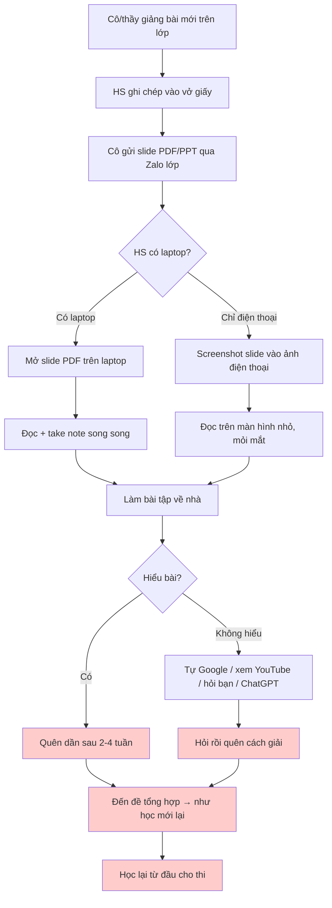
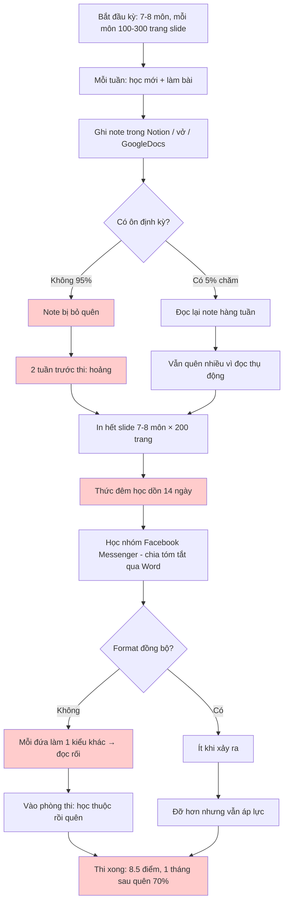
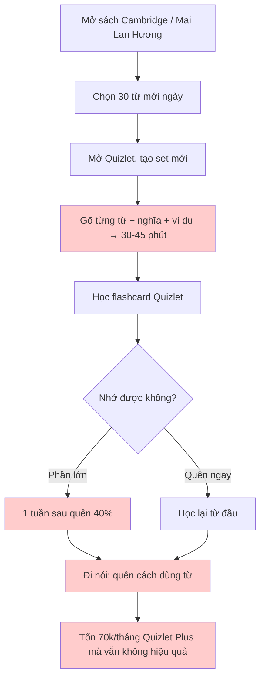

# As-Is Flow — Cách người học VN học HIỆN TẠI

**Ngày:** 2026-05-16
**Phiên bản:** 1.0

> Tổng hợp từ 7 interview giả lập (3 HS, 3 SV, 1 IELTS). Cần validate bằng interview thật.

---

## Flow 1 — HS THPT học 1 chương mới

**Pain hot spots (đỏ):**
- Quên sau 2-4 tuần
- Học/hỏi xong quên ngay
- Ôn lại từ đầu = phí thời gian

---

## Flow 2 — SV ĐH ôn thi cuối kỳ

**Pain hot spots:**
- Không ôn định kỳ trong kỳ
- Học dồn 2 tuần trước thi → burnout
- Học nhóm không đồng bộ format
- Quên 70% sau 1 tháng

---

## Flow 3 — Học viên IELTS học vocab (v0.2 context)

**Pain hot spots:**
- Nhập tay 30-45 phút/ngày — tốn TG hơn cả học
- Nhớ nghĩa nhưng không biết dùng
- Trả tiền nhưng không hiệu quả

---

## Tổng kết các "hot spot" chung

| # | Hot spot | Persona ảnh hưởng | Tần suất | Severity |
|---|----------|-------------------|----------|----------|
| H1 | **Quên kiến thức sau 2-4 tuần** | HS + SV + IELTS | Mọi user | 🔥🔥🔥 |
| H2 | **Tổng hợp slide dài thủ công** | HS + SV | Mỗi tuần | 🔥🔥🔥 |
| H3 | **Nhập liệu thủ công vào tool** | IELTS, một số HS | Mỗi ngày | 🔥🔥 |
| H4 | **Học dồn cuối kỳ → burnout** | SV chủ yếu | Mỗi kỳ thi | 🔥🔥🔥 |
| H5 | **Học nhóm không đồng bộ** | SV + HS chuyên | Trong nhóm | 🔥🔥 |
| H6 | **Không biết yếu skill gì** | IELTS, HS thi ĐH | Trước thi | 🔥🔥 |
| H7 | **Học sinh tỉnh không có laptop** | HS + SV tỉnh | Chronic | 🔥🔥 |
| H8 | **Không có Visa Card để trả app nước ngoài** | HS + SV cấp trung | Khi muốn upgrade | 🔥 |
| H9 | **App nước ngoài quá đắt** | Tất cả | Khi cân nhắc | 🔥🔥 |
| H10 | **ChatGPT mất context giữa session** | Power users | Mỗi session | 🔥 |

---

## Mỗi pain → giải pháp tiềm năng (preview cho `04-flow-to-be.md`)

| Pain | Não Cá Vàng giải thế nào |
|------|--------------------------|
| H1 Quên kiến thức | **Spaced repetition tự động** trên mind map |
| H2 Tổng hợp slide dài | **AI sinh mind map từ PDF/PPT** trong 30 giây |
| H3 Nhập liệu thủ công | **AI tự sinh flashcard từ mind map** |
| H4 Học dồn cuối kỳ | **Smart reminder ôn theo lịch thi** |
| H5 Học nhóm không đồng bộ | **Mind map collaborative** (v0.2/v1.0) |
| H6 Không biết yếu skill gì | **Analytic dashboard** (v0.2-v1.0) |
| H7 HS tỉnh không laptop | **Responsive web tốt + PWA** + mobile v0.3 |
| H8 Không có Visa | **MoMo / ZaloPay / VNPay** (v0.2) |
| H9 App nước ngoài đắt | **Pricing VN: 49-99k/tháng** (+ free tier rộng + gói SV 39k) |
| H10 ChatGPT mất context | **AI persistent context per mind map** |
