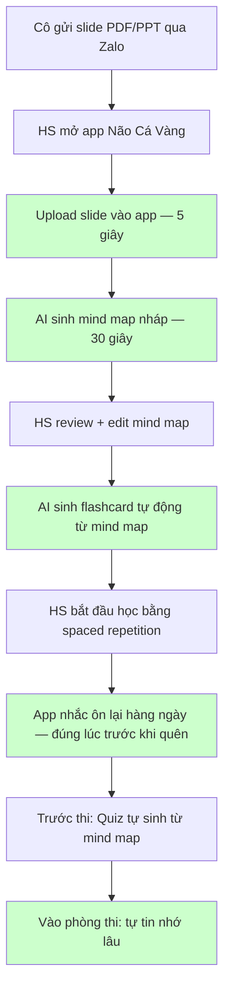
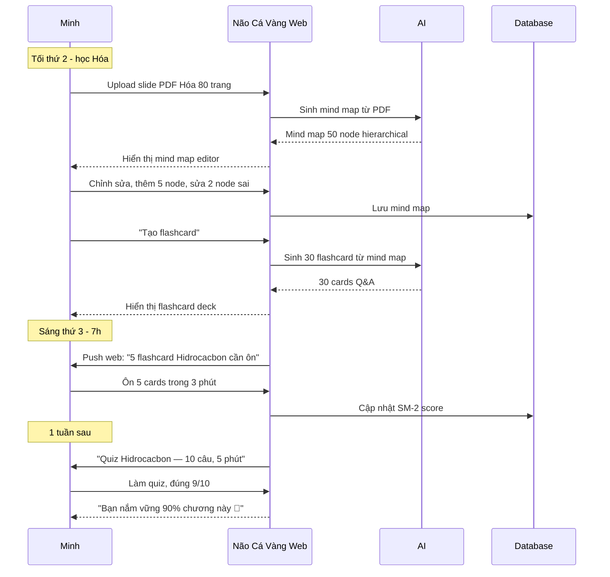
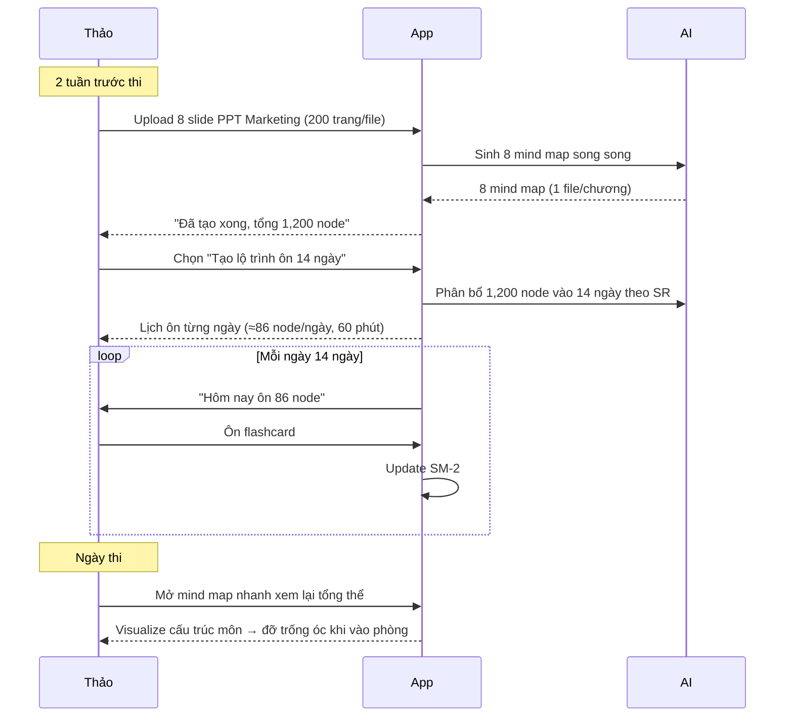

# To-Be Flow — Cách người học dùng Não Cá Vàng

**Ngày:** 2026-05-16
**Phiên bản:** 1.0
**Scope:** Workflow ở MVP v0.1 (Web only, 7 features cốt lõi)

---

## Flow chính — HS THPT học 1 chương mới với Não Cá Vàng



**Tiết kiệm thời gian/lợi ích:**
- Tổng hợp slide: **3 giờ → 5 phút** (tiết kiệm 97%)
- Quên kiến thức: **70% → 20%** (Spaced repetition)
- Stress thi cử: giảm rõ rệt

---

## Flow chi tiết theo persona

### Persona HS THPT — Minh (lớp 11)



---

### Persona SV ĐH — Thảo (NEU năm 3, ôn thi Marketing)



---

## Trải nghiệm 5 user journey trong MVP v0.1

### Journey A — Đăng ký lần đầu (0 → 1)
```
1. Vào nao-ca-vang.com
2. Click "Bắt đầu miễn phí"
3. Đăng ký Google trong 1 click (hoặc email)
4. Wizard onboarding 30 giây: chọn vai trò (HS/SV/Khác), môn quan tâm
5. Tutorial 2 phút: tạo mind map đầu tiên từ template "Lịch sử lớp 12 - bài 1"
6. Onboarding done → có 1 mind map demo có sẵn flashcard
```

### Journey B — Upload PDF lần đầu (1 → 10)
```
1. Click "Mind map mới" → "Từ PDF"
2. Drag-drop file slide_hoa12.pdf (10MB)
3. Loading spinner + progress: "Đang đọc PDF..." (10s) → "Đang sinh mind map..." (20s)
4. Hiển thị mind map + banner "AI sinh từ slide. Bạn có thể chỉnh sửa."
5. User edit thêm 5 node trong 3 phút
6. Auto-save liên tục, indicator "Đã lưu lúc 19:23"
```

### Journey C — Học flashcard ngày
```
1. Mở dashboard
2. Banner: "Hôm nay bạn có 12 thẻ cần ôn (5 phút)"
3. Click "Bắt đầu ôn"
4. Flashcard mode: hiện Q, click "Hiện đáp án", tự đánh giá (Lại / Khó / Tốt / Dễ)
5. Đánh giá xong → SM-2 schedule lần next
6. Khi xong 12 thẻ → "Hoàn thành! +25 XP. Streak 5 ngày 🔥"
```

### Journey D — Quiz tự sinh
```
1. Vào 1 mind map → click "Quiz"
2. Chọn cấu hình: 10 câu / Trắc nghiệm + Điền khuyết / Khó: TB
3. AI sinh quiz trong 10s
4. User làm quiz
5. Submit → hiện điểm + giải thích từng câu
6. Câu sai → tự động thêm vào flashcard deck để ôn
```

### Journey E — Sử dụng template
```
1. Vào "Thư viện template" → filter "Lớp 12 - Hóa"
2. Click template "Hữu cơ - Hidrocacbon" → preview
3. Click "Dùng template này"
4. Mind map copy về cá nhân, bắt đầu edit
```

---

## NFR — Performance & UX cam kết với user

| # | Cam kết | Lý do |
|---|---------|-------|
| 1 | AI sinh mind map từ PDF < 60 giây cho file 100 trang | Pain "Slide 80 trang em đóng đi xem TikTok" |
| 2 | Mind map render < 2 giây cho 500 node | Thảo: Notion 200 trang chậm |
| 3 | Auto-save < 500ms sau mỗi edit | Tránh mất công sửa |
| 4 | Responsive tốt trên điện thoại tầm trung | Linh không có laptop |
| 5 | Free tier: 10 mind map + 50 AI gen / tháng | Mai SV Y phải tính từng đồng |
| 6 | Hỗ trợ MoMo + ZaloPay + VNPay (v0.2) | Linh không có Visa |
| 7 | UI 100% tiếng Việt | USP chính |

---

## Pain → To-Be mapping (chi tiết)

| As-Is Pain | To-Be Solution | Feature trong MVP? |
|------------|----------------|---------------------|
| Quên sau 2-4 tuần (H1) | Spaced repetition SM-2 trên flashcard tự sinh | ✅ MVP v0.1 |
| Tổng hợp slide 80 trang (H2) | AI sinh mind map từ PDF | ✅ MVP v0.1 |
| Nhập từ vựng 30-45 phút (H3) | AI sinh flashcard tự động | ✅ MVP v0.1 |
| Học dồn cuối kỳ (H4) | Smart reminder lịch ôn | ✅ MVP v0.1 (cơ bản, refine sau) |
| Học nhóm không đồng bộ (H5) | Mind map collaborative | ⏳ v0.2 hoặc v1.0 |
| Không biết yếu skill gì (H6) | Analytic dashboard | ⏳ v0.2 |
| HS tỉnh không laptop (H7) | Responsive + PWA | ✅ MVP v0.1 (responsive) |
| Không có Visa (H8) | MoMo/ZaloPay/VNPay | ⏳ v0.2 |
| App nước ngoài đắt (H9) | Pricing VN 49-99k + free tier | ✅ MVP v0.1 (free tier) |
| ChatGPT mất context (H10) | AI context per mind map | ✅ MVP v0.1 (basic) |
