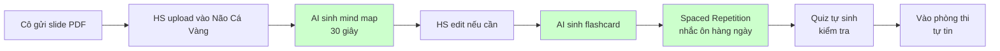

# Business Requirements Document — Não Cá Vàng

**Version:** 1.0
**Date:** 2026-05-16
**Author:** BA Discovery (Quân Nguyễn proxy)
**Approver:** Quân Nguyễn (Founder + Sponsor — own product mode)
**Status:** ✅ APPROVED (self-signed, see §11)

---

## 1. Executive Summary

### 1.1 Mục tiêu dự án

**Não Cá Vàng** là nền tảng học tập Web + Mobile App giúp người học Việt Nam **học nhanh hơn, nhớ lâu hơn** thông qua sự kết hợp giữa **sơ đồ tư duy (mind map)**, **trí tuệ nhân tạo (AI sinh nội dung tự động)** và **phương pháp lặp lại ngắt quãng (spaced repetition)**.

> **Tagline:** *"Não Cá Vàng — Nơi trí nhớ không còn là vấn đề."*

Sản phẩm đặt mục tiêu trở thành **công cụ học tập all-in-one đầu tiên dành riêng cho người Việt**, thay thế việc dùng song song 3-5 ứng dụng (Quizlet + Anki + Notion + ChatGPT + Xmind) bằng một nền tảng duy nhất, Việt hóa toàn diện, với giá phù hợp túi tiền học sinh - sinh viên Việt Nam.

### 1.2 Lợi ích kinh doanh

| # | Lợi ích | Đo lường |
|---|---------|----------|
| 1 | Giảm thời gian tổng hợp slide bài giảng từ **3 giờ → 5 phút** | Time tracking trong app |
| 2 | Giảm tỷ lệ quên kiến thức sau 1 tháng từ **70% → 20%** | Quiz retention test |
| 3 | Tạo dòng doanh thu **25-50 triệu VND/tháng MRR sau 6 tháng** | Stripe/MoMo dashboard |
| 4 | Đạt **10,000 user / 500 paying** sau 6 tháng | Analytics dashboard |
| 5 | Giảm stress thi cử cho sinh viên (NPS ≥ 30) | User survey |

### 1.3 Stakeholders

| Vai trò | Tên | Trách nhiệm |
|---------|-----|-------------|
| Founder + Sponsor | Quân Nguyễn | Funding, vision, approve |
| Project Manager | (AI agent) | Sprint planning, scope discipline |
| Business Analyst | (AI agent) | Requirement |
| Tech Lead | (AI agent) | Architecture, tech decision |
| Senior Developer | (AI agent) | Implementation |
| QA / Tester | (AI agent) | Verify quality |
| End users | HS THPT + SV ĐH (MVP v0.1) | Sử dụng + feedback |

---

## 2. Bối cảnh & Vấn đề Hiện tại

### 2.1 Quy trình học hiện tại (As-Is)

Tham chiếu: [docs/discovery/03-flow-as-is.md](../discovery/03-flow-as-is.md)

**Tóm tắt:** Người học VN hiện đang:
- Ghi chép vở giấy / Notion / GoodNotes — không hệ thống
- Học từ slide PDF/PPT cô thầy gửi qua Zalo — thường 80-300 trang/môn
- Dùng Quizlet/Anki cho flashcard — phải nhập thủ công, tốn 30-45 phút/ngày
- Không có cơ chế nhắc ôn → quên 70% kiến thức sau 1 tháng
- Học dồn 2 tuần trước thi → stress, burnout (có case nhập viện)

### 2.2 Pain points top 5

| # | Vấn đề | Tần suất | Mức độ |
|---|--------|---------|--------|
| 1 | **Quên kiến thức sau 2-4 tuần** | Mọi user | 🔥🔥🔥 HIGH |
| 2 | **Tổng hợp slide dài 100+ trang là cực hình** | Hàng tuần | 🔥🔥🔥 HIGH |
| 3 | **Nhập liệu thủ công vào Quizlet/Notion tốn 30-45 phút/ngày** | Hàng ngày | 🔥🔥 HIGH |
| 4 | **Học dồn cuối kỳ → burnout, ngủ 4h/đêm, nhập viện** | Mỗi kỳ thi | 🔥🔥🔥 HIGH |
| 5 | **App nước ngoài đắt + không có Visa Card để thanh toán** | Khi upgrade | 🔥🔥 MED-HIGH |

### 2.3 Quotes từ user (Discovery output)

> *"Cô gửi PDF 80 trang trên Zalo, em mở ra thấy nản, đóng lại đi xem TikTok."*
> — Minh, HS lớp 11

> *"Em qua môn 8.5 điểm. Sang năm 3 cần lại kiến thức môn đó em quên hết."*
> — Thảo, SV NEU năm 3

> *"Em nhập viện vì stress 2 lần trong 2 năm rồi."*
> — Thảo

> *"Em muốn dùng Quizlet Plus nhưng nhà em không có thẻ Visa."*
> — Linh, HS Thanh Hóa

> *"Em sẵn sàng trả 200k/tháng nếu thay được Obsidian + Anki + ChatGPT."*
> — An, HS chuyên Toán

---

## 3. Mục tiêu & Phạm vi (Scope)

### 3.1 Mục tiêu cụ thể (SMART)

| # | Mục tiêu | Đo lường | Deadline |
|---|----------|----------|----------|
| O1 | Launch MVP v0.1 Web với 7 features cốt lõi | Public URL live | **15/07/2026** |
| O2 | Đạt 1,000 user đăng ký trong 3 tháng đầu | Analytics | 15/10/2026 |
| O3 | Đạt 5% conversion free → Premium | Stripe dashboard | 15/10/2026 |
| O4 | NPS ≥ 30 sau 3 tháng | In-app survey | 15/10/2026 |
| O5 | Đạt 10,000 user / 500 paying / ~25-50M MRR | Dashboard | 15/01/2027 |

### 3.2 In Scope MVP v0.1 (PHẢI làm — 7 features cốt lõi)

| # | Feature | Mô tả ngắn |
|---|---------|------------|
| F1 | **Authentication** | Đăng ký + đăng nhập Email + Google. Onboarding wizard 30s |
| F2 | **Mind Map Editor** | Kéo thả node, tạo nhánh, đổi màu, embed image, auto-save |
| F3 | **AI Generate from PDF/Text** | Upload PDF (max 100 trang) hoặc paste text → AI sinh mind map nháp |
| F4 | **Flashcard tự sinh** | Mỗi node mind map → flashcard Q&A. Bulk + on-demand |
| F5 | **Spaced Repetition (SM-2)** | Lịch ôn tự động, dashboard "hôm nay ôn gì" |
| F6 | **Quiz tự sinh** | Trắc nghiệm + Điền khuyết, AI generate từ mind map |
| F7 | **Template Library** | 50+ template sẵn theo môn (Toán/Lý/Hóa/Sử/IELTS) |

### 3.3 Out of Scope MVP v0.1 (KHÔNG làm)

- ❌ Mobile app native (sẽ làm ở v0.3 — Sprint 9-12)
- ❌ AI sinh từ ảnh chụp / YouTube (v0.2 — Sprint 7-8)
- ❌ Thư viện public + social features (v0.2)
- ❌ Real-time collaboration mind map nhóm (v0.2-v1.0 — VERIFY V-105)
- ❌ Marketplace bán mind map của giáo viên (v1.0)
- ❌ Payment (chỉ free tier ở v0.1, Premium ở v0.2)
- ❌ Pomodoro timer / Study timer (nice-to-have)
- ❌ Multi-language (chỉ tiếng Việt ở v0.1, EN ở v1.0)

> ⚠️ **Quan trọng:** Mọi yêu cầu phát sinh ngoài scope này sẽ qua Change Request process (xem §10).

### 3.4 Roadmap (Future considerations)

| Phase | Thời gian | Features chính | Mục tiêu |
|-------|-----------|----------------|----------|
| **v0.1 MVP** | 8 tuần (đến 15/07/2026) | 7 features cốt lõi (§3.2) | Launch, có user thật |
| **v0.2** | +4 tuần (đến 15/08/2026) | AI từ ảnh + YouTube, thư viện public, Premium subscription (MoMo/ZaloPay/VNPay) | Monetize + viral loop |
| **v0.3** | +6 tuần (đến 30/09/2026) | Mobile app (React Native), offline mode, push notification | Mở rộng platform |
| **v1.0** | +6 tuần (đến 15/11/2026) | Học nhóm collaborative, marketplace, follow/comment | Cộng đồng |

---

## 4. Quy trình Mong muốn (To-Be)

### 4.1 To-Be Flow

Tham chiếu: [docs/discovery/04-flow-to-be.md](../discovery/04-flow-to-be.md)



**Tiết kiệm:**
- Tổng hợp slide: **3 giờ → 5 phút** (-97%)
- Tỷ lệ quên kiến thức: **70% → 20%** (-71%)
- Stress thi cử: giảm rõ rệt

### 4.2 Use cases chính (high-level)

| # | Use case | Actor | Mô tả 1 câu |
|---|----------|-------|-------------|
| UC-01 | Đăng ký + onboarding | New user | User đăng ký Google trong 1 click, chọn vai trò + môn quan tâm |
| UC-02 | Tạo mind map thủ công | All user | Mở editor, kéo thả node, lưu |
| UC-03 | Sinh mind map từ PDF | All user | Upload PDF → AI sinh mind map → edit |
| UC-04 | Sinh flashcard từ mind map | All user | 1 click → 30 flashcard tự sinh |
| UC-05 | Ôn flashcard hàng ngày | All user | Dashboard hiện "12 thẻ cần ôn hôm nay" → học |
| UC-06 | Làm quiz | All user | Vào mind map → "Tạo quiz" → làm → review |
| UC-07 | Dùng template | All user | Browse thư viện → chọn template → copy về cá nhân → edit |

---

## 5. Yêu cầu Phi chức năng (Non-Functional, business-friendly)

| Khía cạnh | Yêu cầu |
|-----------|---------|
| **Hiệu năng** | Mind map < 2s load, AI sinh mind map < 60s cho PDF 100 trang, app dùng tốt trên điện thoại tầm trung (Redmi Note 11) |
| **Bảo mật** | Tuân thủ Decree 13/2023 PDPL Việt Nam, mã hóa thông tin cá nhân, HTTPS |
| **Khả dụng** | 99% uptime trong giờ học (8h-23h), backup hàng giờ |
| **Mobile** | Responsive cho điện thoại Android/iOS — PWA cache offline |
| **Ngôn ngữ** | Tiếng Việt 100% UI, content, error message |
| **Mạng yếu** | Hoạt động được trên 3G chập chờn (HS tỉnh) |
| **Đào tạo** | Onboarding tooltip + video demo 2 phút trong app |

---

## 6. Constraints & Assumptions

### 6.1 Constraints (giới hạn cứng)

- **Timeline:** MVP v0.1 phải launch trong 8 tuần
- **Team:** Solo developer (Quân) + AI agents
- **Budget AI:** $50-100/tháng pre-revenue (xem [VERIFY_LATER.md V-003](../../VERIFY_LATER.md))
- **Compliance:** Decree 13/2023 PDPL VN
- **Platform:** Web first, mobile sau (v0.3)
- **Language:** Tiếng Việt 100%

### 6.2 Assumptions (giả định — cần verify)

- HS/SV VN có internet & thiết bị tối thiểu (smartphone)
- Cô/thầy gửi slide qua Zalo dưới dạng PDF/PPTX (phổ biến)
- AI provider (Gemini/Claude) ổn định, không tăng giá đột biến
- 7 persona giả lập (Phase 2) phản ánh đúng user thật — VERIFY V-101

---

## 7. Success Criteria

Dự án được xem là **THÀNH CÔNG** khi tất cả tiêu chí sau đạt:

- [ ] **Launch:** MVP v0.1 live trước 15/07/2026
- [ ] **Functionality:** 7 features cốt lõi hoạt động đúng spec SRS
- [ ] **Quality:** 0 critical bug, < 5 high bug trong 30 ngày đầu sau launch
- [ ] **Performance:** AI sinh mind map < 60s cho PDF 100 trang (p95)
- [ ] **Adoption:** 1,000 user đăng ký trong 3 tháng
- [ ] **Retention:** D30 ≥ 25%
- [ ] **Satisfaction:** NPS ≥ 30
- [ ] **Revenue (v0.2+):** 25-50M MRR sau 6 tháng từ launch

---

## 8. Risks & Mitigation

| # | Risk | Likelihood | Impact | Mitigation |
|---|------|-----------|--------|------------|
| R1 | AI cost vượt budget khi user tăng đột biến | TB | HIGH | Cache aggressive, rate-limit free tier 50 gen/tháng, dùng Gemini Flash cho bulk |
| R2 | Scope creep — thêm feature ngoài MVP | HIGH | HIGH | PM enforce mỗi sprint, refuse out-of-BRD requests, dùng Change Request process |
| R3 | Chất lượng AI sinh mind map kém → user churn | TB | HIGH | A/B test multi prompt, cho user edit dễ dàng, fallback "draft only" disclaimer |
| R4 | Solo dev burnout trong 6 tháng | HIGH | HIGH | Sprint 2 tuần, không over-commit, dùng tối đa AI agents song song |
| R5 | Competitor (Quizlet/Anki) thêm AI mind map | TB | TB | Launch sớm (8 tuần), USP "Việt + giá VN" khó copy |
| R6 | Adoption chậm — user không hiểu mind map | TB | HIGH | Onboarding có template + video demo, content marketing TikTok |
| R7 | Payment VN khó tích hợp (MoMo/VNPay docs hạn chế) | TB | TB | Spike technical ở Sprint 7, có plan B (VNPay first, MoMo sau) |
| R8 | PDPL/legal vi phạm | LOW | HIGH | Privacy policy + Terms ToS trước launch, tham vấn luật sư khi MRR > 50M |

---

## 9. Timeline (high-level)

| Sprint | Tuần | Output | Date |
|--------|------|--------|------|
| Sprint 0 | T0 | Charter + Discovery + BRD + SRS + Tech Decision | 16/05/2026 ✅ |
| Sprint 1 | T1-2 | Foundation: repo, auth, DB schema, CI/CD, deploy staging | 30/05/2026 |
| Sprint 2 | T3-4 | Mind map editor (kéo thả + lưu DB + template) | 13/06/2026 |
| Sprint 3 | T5-6 | AI sinh mind map từ PDF/text + Flashcard tự sinh | 27/06/2026 |
| Sprint 4 (Alpha) | T7 | Spaced Repetition + Quiz + polish | 04/07/2026 |
| Alpha demo | 30/06/2026 | Demo nội bộ 5-10 user feedback | |
| Sprint 5 (Launch) | T8 | Bug fix + final polish + production deploy | 11/07/2026 |
| **🚀 MVP v0.1 LAUNCH** | **T8** | **Public live** | **15/07/2026** |

---

## 10. Change Management

Khi requirement đổi sau khi BRD ký:

1. Tạo `docs/requirements/changes/CR-NNN.md`:
   ```markdown
   # CR-001: Thêm tính năng X
   - Requested by: <Quân / user feedback>
   - Reason: <vì sao>
   - Impact: timeline +N tuần, cost +M VND, AI cost +X/tháng
   - Decision: APPROVED / REJECTED / DEFERRED (lý do)
   - Approver: Quân Nguyễn
   ```
2. Quân sign-off → update BRD v1.1 + SRS v1.1
3. Update timeline + sprint plan

KHÔNG implement requirement mới mà không qua CR process.

---

## 11. Approval & Signoff

Bằng việc ký dưới đây, bên ký xác nhận đồng ý với scope, timeline, budget và success criteria nêu trên.

**Sponsor / Founder:**
Họ tên: **Nguyễn Đăng Quân (Quân Nguyễn)**
Vai trò: **Founder + Sponsor**
Ký tên: **✅ APPROVED (self-signed in own product mode)**
Ngày: **2026-05-16**

**BA (Author):**
Họ tên: **BA Discovery agent (Quân Nguyễn proxy)**
Vai trò: **Business Analyst**
Ngày: **2026-05-16**

---

## Phụ lục

- A. Project Charter → [docs/charter/PROJECT_CHARTER.md](../charter/PROJECT_CHARTER.md)
- B. Stakeholder map → [docs/discovery/01-stakeholders.md](../discovery/01-stakeholders.md)
- C. Interview transcripts → [docs/discovery/interviews/](../discovery/interviews/)
- D. Persona cards → [docs/discovery/05-opportunities.md](../discovery/05-opportunities.md#-persona-cards)
- E. SRS technical → [docs/requirements/SRS-v1.0.md](./SRS-v1.0.md) (next step)
- F. Verify later items → [VERIFY_LATER.md](../../VERIFY_LATER.md)

---

**🟢 Status: APPROVED — Ready for SRS (Phase 3.2) → Tech Decision (Phase 4) → Sprint 1.**
