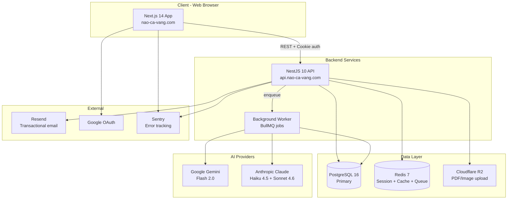
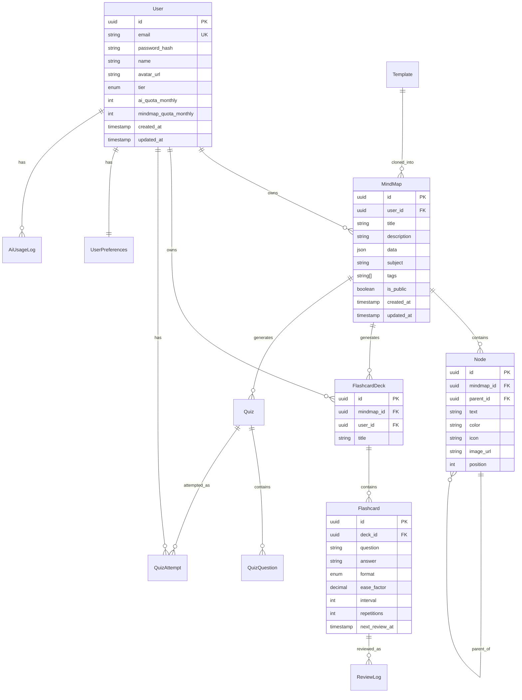

# Software Requirements Specification — Não Cá Vàng

**Version:** 1.0
**Date:** 2026-05-16
**Based on:** BRD-v1.0 (approved 2026-05-16)
**Author:** BA + Tech Lead (AI agents)
**Reviewers:** Tech Lead, Senior Dev, QA agent
**Status:** ✅ APPROVED — Ready for Sprint 1

---

## 1. Introduction

### 1.1 Purpose

SRS này dịch BRD-v1.0 thành specification technical đủ chi tiết để dev team (AI agents + Quân) implement MVP v0.1 mà không cần hỏi lại.

### 1.2 Scope

Reference: BRD-v1.0 §3 (In/Out of Scope). SRS này cover **MVP v0.1 only** — 7 features cốt lõi, Web platform.

### 1.3 Definitions, Acronyms, Abbreviations

| Term | Definition |
|------|-----------|
| **Mind Map (MM)** | Sơ đồ tư duy — cây hierarchical với root + branches + leaf nodes |
| **Node** | Đơn vị trong mind map: text + optional image + children |
| **Card / Flashcard** | Q&A card sinh từ node, dùng cho ôn tập SR |
| **SR (Spaced Repetition)** | Phương pháp ôn lặp ngắt quãng. SRS dùng thuật toán SM-2 |
| **SM-2** | SuperMemo 2 algorithm — tính interval ôn dựa trên difficulty + repetition |
| **Quiz** | Bài kiểm tra trắc nghiệm / điền khuyết, AI sinh từ mind map |
| **Template** | Mind map mẫu sẵn, user copy về cá nhân để dùng |
| **AI Gen** | Lần gọi AI sinh nội dung (mind map / flashcard / quiz) |
| **DAU/MAU** | Daily/Monthly Active User |
| **PII** | Personally Identifiable Information |
| **PDPL** | Personal Data Protection Law (Decree 13/2023 VN) |

### 1.4 References

- [BRD-v1.0](./BRD-v1.0.md) — business requirement
- [Project Charter](../charter/PROJECT_CHARTER.md)
- [Discovery Output](../discovery/05-opportunities.md)
- [VERIFY_LATER.md](../../VERIFY_LATER.md) — uncertain assumptions
- ADR-001 đến ADR-005 trong `docs/adr/`

---

## 2. Overall Description

### 2.1 Product Perspective



### 2.2 User Classes

| Class | Permissions | Description |
|-------|-------------|-------------|
| **Guest** | View landing page, đăng ký | Chưa đăng nhập |
| **Free User** | 10 mind map / tháng, 50 AI gen / tháng, basic features | Tier mặc định khi đăng ký |
| **Premium User** (v0.2) | Unlimited mind map, 500 AI gen / tháng, advanced features | Paid 99k/tháng |
| **Pro User** (v0.2) | Unlimited everything, AI Sonnet model | Paid 199k/tháng (xem [V-106](../../VERIFY_LATER.md#v-106)) |
| **Admin** | Full system access, user management, content moderation | Quân + (tương lai) staff |

### 2.3 Operating Environment

| Layer | Tech | Version |
|-------|------|---------|
| Frontend | Next.js (App Router) + React | 14.x / 18.x |
| UI Library | shadcn/ui + Tailwind CSS | latest |
| Mind Map Editor | React Flow (xyflow) | 12.x |
| Backend | NestJS + Node.js | 10.x / 20 LTS |
| Database | PostgreSQL | 16.x |
| Cache + Queue | Redis | 7.x |
| ORM | Prisma | 5.x |
| Job Queue | BullMQ | 5.x |
| Auth | NextAuth.js (Auth.js) | 5.x (beta) — JWT strategy |
| Hosting FE | Vercel | — |
| Hosting BE+DB | Railway | — |
| Object storage | Cloudflare R2 (S3-compat) | — |
| Email | Resend | — |
| Monitoring | Sentry + Better Stack | — |
| AI Provider 1 | Google Gemini API (Flash 2.0) | — |
| AI Provider 2 | Anthropic Claude API (Haiku 4.5, Sonnet 4.6) | — |

**Browser support:** Chrome 110+, Safari 16+, Edge 110+, Firefox 110+
**Mobile responsive:** từ 320px (iPhone SE) trở lên
**Min device:** Xiaomi Redmi Note 11 hoặc tương đương (4GB RAM, Android 11)

### 2.4 Design and Implementation Constraints

- **TypeScript end-to-end** (FE + BE) — strict mode
- **Clean Architecture** (4 layer: Presentation / Application / Domain / Infrastructure)
- **DDD module style** — mỗi feature là 1 module riêng (auth, mindmap, flashcard, quiz, ai, template)
- **API responses follow chuẩn JSON** (theo `architecture.md` rules) — `{success, data, meta}` hoặc `{success: false, error}`
- **Mind map data:** JSONB trong PostgreSQL (xem ADR-002)
- **AI calls:** async qua BullMQ worker, không block API thread
- **i18n:** Tiếng Việt primary (next-intl), structure sẵn để add EN sau
- **PDPL compliance:** PII encrypted at rest (email, password hash, phone), data retention max 5 năm
- **Rate limiting:** 100 req/min/user, 1000 req/min/IP

---

## 3. Functional Requirements

### 3.1 Module: Authentication

#### FR-001: Đăng ký user mới

**User Story:** Là một **người học**, tôi muốn **đăng ký tài khoản trong < 30 giây** để **bắt đầu dùng app ngay không bị friction**.

**Acceptance Criteria:**
- **AC1:** Cung cấp 2 cách đăng ký: Email/Password và Google OAuth
- **AC2:** Email/Password: validate email format, password ≥ 8 chars + 1 số + 1 chữ
- **AC3:** Google OAuth: 1-click với Google account, auto-fill name + avatar
- **AC4:** Tạo user record với defaults: `tier = 'free'`, `aiQuotaMonthly = 50`, `mindmapQuotaMonthly = 10`
- **AC5:** Gửi welcome email qua Resend trong 1 phút (không block đăng ký)
- **AC6:** Redirect đến onboarding wizard (FR-002)
- **AC7:** Edge case: email đã tồn tại → message "Email đã được dùng. Đăng nhập?"
- **AC8:** Rate limit: max 5 đăng ký/IP/giờ (chống spam)

**Priority:** P0 | **Effort:** 5 SP | **Sprint:** 1

#### FR-002: Onboarding wizard

**User Story:** Là **user mới**, tôi muốn **hiểu app làm gì trong < 2 phút** để **không bỏ ngay sau đăng ký**.

**Acceptance Criteria:**
- **AC1:** 3 bước wizard:
  - Step 1: Chọn vai trò (HS THPT / SV ĐH / Khác)
  - Step 2: Chọn 3 môn quan tâm (Toán, Lý, Hóa, Sử, Anh, ...)
  - Step 3: Tạo mind map mẫu từ template phù hợp với lựa chọn
- **AC2:** Có nút "Bỏ qua" ở mỗi bước
- **AC3:** Sau hoàn thành: dashboard với 1 mind map sẵn + tutorial tooltip
- **AC4:** Lưu preferences vào `user_preferences` table

**Priority:** P0 | **Effort:** 3 SP | **Sprint:** 1

#### FR-003: Đăng nhập

**Acceptance Criteria:**
- **AC1:** Email + Password OR Google OAuth
- **AC2:** Session duration: 30 ngày (NextAuth JWT)
- **AC3:** "Quên mật khẩu" → reset link qua email, valid 1 giờ
- **AC4:** Rate limit: 5 attempts/email/15 phút → lock 30 phút
- **AC5:** Login fail → message chung "Email hoặc mật khẩu không đúng" (không leak existence)

**Priority:** P0 | **Effort:** 3 SP | **Sprint:** 1

---

### 3.2 Module: Mind Map Editor

#### FR-010: Tạo mind map thủ công

**User Story:** Là **user**, tôi muốn **tạo mind map từ đầu** để **note ý tưởng tự do**.

**Acceptance Criteria:**
- **AC1:** Click "+ Mind map mới" → mở editor với 1 root node "Chủ đề"
- **AC2:** Editor tools: thêm node con (Tab), node anh em (Enter), xóa (Delete), undo/redo (Ctrl+Z/Y)
- **AC3:** Mỗi node có: text (max 200 chars), color (10 màu preset), icon (optional), image embed (tối đa 5MB)
- **AC4:** Layout: tự động hierarchical (left/right of root) — dùng `dagre` layout của React Flow
- **AC5:** Zoom in/out + pan
- **AC6:** Auto-save mỗi 500ms sau edit, indicator "Đã lưu lúc HH:MM"
- **AC7:** Mind map metadata: title, description, tags, subject (Toán/Lý/...), createdAt, updatedAt
- **AC8:** Quota free user: max 10 mind map active (xem [V-104](../../VERIFY_LATER.md#v-104))

**Priority:** P0 | **Effort:** 13 SP | **Sprint:** 2

#### FR-011: Performance mind map editor

**Acceptance Criteria:**
- **AC1:** Render < 2s cho mind map 500 node
- **AC2:** Edit interaction < 100ms (add/delete node)
- **AC3:** Auto-save < 500ms (non-blocking)
- **AC4:** Memory < 200MB browser cho 1 mind map 1000 node
- **AC5:** POC ở Sprint 1 để verify limits — xem [V-202](../../VERIFY_LATER.md#v-202), [V-304](../../VERIFY_LATER.md#v-304)

**Priority:** P0 | **Effort:** 3 SP (POC) | **Sprint:** 1

#### FR-012: Embed image vào node

**Acceptance Criteria:**
- **AC1:** Click node → button "Thêm ảnh" → upload image (max 5MB, JPG/PNG/WEBP)
- **AC2:** Upload qua Cloudflare R2, return CDN URL
- **AC3:** Resize tự động: max width 800px (giữ aspect ratio)
- **AC4:** Hiển thị thumbnail trong node, full image khi click

**Priority:** P1 | **Effort:** 5 SP | **Sprint:** 2

---

### 3.3 Module: AI Generation

#### FR-020: Sinh mind map từ PDF/Text

**User Story:** Là **HS THPT**, tôi muốn **upload slide PDF 80 trang và nhận mind map trong < 60s** để **không phải tự tóm tắt**.

**Acceptance Criteria:**
- **AC1:** Input: Upload PDF (max 50MB, max 100 trang) HOẶC paste text (max 20,000 chars)
- **AC2:** UI: drag-drop zone hoặc file picker. Progress bar khi upload + AI gen
- **AC3:** Pipeline:
  1. Extract text từ PDF (pdf-parse hoặc pdf2json)
  2. Chunk text nếu > 8000 tokens (split theo trang)
  3. Gọi AI (Gemini Flash mặc định) với prompt template (xem §11 Phụ lục)
  4. Parse JSON response → mind map structure
  5. Save vào DB, return mind map ID
- **AC4:** Response time: p50 < 30s, p95 < 60s, p99 < 120s
- **AC5:** Hiển thị mind map với banner: *"⚡ AI sinh từ tài liệu. Bạn có thể chỉnh sửa."*
- **AC6:** Quota: tính 1 AI gen cho mỗi mind map generated
- **AC7:** Edge case PDF lỗi/scan-image → fallback OCR (v0.2) hoặc message "PDF không đọc được, vui lòng paste text"
- **AC8:** Edge case AI fail → retry 2 lần, sau đó hoàn quota + message lỗi
- **AC9:** Edge case PDF quá dài (> 100 trang) → split UI cho user chọn pages

**Priority:** P0 | **Effort:** 21 SP | **Sprint:** 3

**Dependencies:** Cloudflare R2 setup, AI provider config, BullMQ worker

#### FR-021: AI model routing strategy

**Acceptance Criteria:**
- **AC1:** Tier free → Gemini Flash 2.0 (cost ~$0.075/1M token input)
- **AC2:** Tier Premium (v0.2) → Claude Haiku 4.5 cho mind map, Sonnet 4.6 cho quiz khó
- **AC3:** Tier Pro (v0.2) → Claude Sonnet 4.6 cho mọi task
- **AC4:** Routing logic centralized trong `AiRoutingService` (xem ADR-005)
- **AC5:** Log model + cost mỗi request vào `ai_usage_log` table
- **AC6:** Verify ở [V-305](../../VERIFY_LATER.md#v-305) sau Sprint 3

**Priority:** P0 | **Effort:** 5 SP | **Sprint:** 3

---

### 3.4 Module: Flashcard

#### FR-030: Sinh flashcard từ mind map

**User Story:** Là **user**, tôi muốn **sinh flashcard tự động từ mind map** để **không phải nhập tay**.

**Acceptance Criteria:**
- **AC1:** Trong mind map editor → button "Tạo flashcard"
- **AC2:** AI sinh Q&A từ mỗi node leaf (hoặc tất cả node nếu user chọn)
- **AC3:** Format mặc định: Q = "Định nghĩa/Giải thích [node text]?" A = nội dung suy từ parent + children
- **AC4:** Hỗ trợ 3 format: Q&A basic, Cloze deletion (điền khuyết), Multi-choice
- **AC5:** Mỗi mind map → 1 deck. User edit deck trước khi save.
- **AC6:** Lưu cards vào `flashcard` table, link với `mindmap_id`
- **AC7:** Quota: tính như 1 AI gen
- **AC8:** Performance: 50 cards generated < 30s

**Priority:** P0 | **Effort:** 13 SP | **Sprint:** 3

#### FR-031: Ôn flashcard

**Acceptance Criteria:**
- **AC1:** Dashboard hiện: "Hôm nay bạn có N thẻ cần ôn (~X phút)"
- **AC2:** Click "Bắt đầu ôn" → flashcard mode full screen
- **AC3:** Hiện Q → click "Hiện đáp án" → hiện A
- **AC4:** User self-rate 4 mức: Lại (1) / Khó (2) / Tốt (3) / Dễ (4)
- **AC5:** Đánh giá xong → SM-2 calculate next interval → schedule
- **AC6:** Khi xong tất cả: confetti + stat "+25 XP, Streak X ngày 🔥"
- **AC7:** Có thể pause / quit giữa chừng, state lưu

**Priority:** P0 | **Effort:** 8 SP | **Sprint:** 4

---

### 3.5 Module: Spaced Repetition (SM-2)

#### FR-040: SM-2 algorithm

**Acceptance Criteria:**
- **AC1:** Mỗi card có fields: `ease_factor` (default 2.5), `interval` (days, default 0), `repetitions` (default 0), `next_review_at` (timestamp)
- **AC2:** Sau mỗi review với quality (0-4):
  - q=0,1,2 (Lại/Khó): reset repetitions=0, interval=1 day
  - q=3 (Tốt): repetitions++, interval = previous interval × ease_factor
  - q=4 (Dễ): repetitions++, interval = previous interval × ease_factor × 1.3
- **AC3:** Update ease_factor: `EF' = EF + (0.1 - (5-q) × (0.08 + (5-q) × 0.02))`, min 1.3
- **AC4:** `next_review_at = now + interval days`
- **AC5:** Query "due today" = `WHERE next_review_at <= now AND user_id = ?`
- **AC6:** Verify ở [V-203](../../VERIFY_LATER.md#v-203) — cân nhắc migrate FSRS sau

**Priority:** P0 | **Effort:** 5 SP | **Sprint:** 4

#### FR-041: Reminder schedule

**Acceptance Criteria:**
- **AC1:** Cron job mỗi ngày 7h sáng (timezone Asia/Ho_Chi_Minh)
- **AC2:** Query users có cards due hôm nay → gửi email reminder (Resend)
- **AC3:** Web notification nếu user đang online
- **AC4:** Push notification (mobile v0.3)
- **AC5:** User có thể disable reminder trong settings

**Priority:** P1 | **Effort:** 5 SP | **Sprint:** 4

---

### 3.6 Module: Quiz

#### FR-050: Sinh quiz từ mind map

**Acceptance Criteria:**
- **AC1:** Trong mind map → button "Tạo quiz"
- **AC2:** Config: số câu (5/10/20), mix type (trắc nghiệm + điền khuyết), độ khó (Dễ/TB/Khó)
- **AC3:** AI sinh quiz trong < 15s
- **AC4:** Trắc nghiệm: 4 option, 1 đúng, có giải thích
- **AC5:** Điền khuyết: câu có ___, list 5 options drag-drop
- **AC6:** Lưu quiz template để dùng lại

**Priority:** P0 | **Effort:** 8 SP | **Sprint:** 4

#### FR-051: Làm quiz + chấm điểm

**Acceptance Criteria:**
- **AC1:** Timer (optional)
- **AC2:** Submit → chấm tự động, hiện điểm + review từng câu
- **AC3:** Câu sai → suggest "Thêm vào flashcard để ôn"
- **AC4:** Lưu attempt vào `quiz_attempts` table cho analytics

**Priority:** P0 | **Effort:** 5 SP | **Sprint:** 4

---

### 3.7 Module: Template Library

#### FR-060: Browse template

**Acceptance Criteria:**
- **AC1:** Trang `/templates` với grid + filter (lớp, môn, tag)
- **AC2:** 50+ template seed sẵn cho MVP (cover: Toán/Lý/Hóa 10-12, Sử/Địa, Anh, IELTS basics)
- **AC3:** Mỗi template có: preview image, title, description, author, # uses, # likes
- **AC4:** Click template → preview chi tiết
- **AC5:** Click "Dùng template này" → copy về private mind map của user

**Priority:** P1 | **Effort:** 5 SP | **Sprint:** 2

#### FR-061: Seed template content

**Acceptance Criteria:**
- **AC1:** Tạo 50 template seed dùng AI generate + human curate
- **AC2:** Lưu trong `templates` table với `is_system = true`
- **AC3:** Cover bộ môn THPT (lớp 10-12) — minimum 30 template
- **AC4:** Cover SV năm 1-2 (Toán cao cấp, Kinh tế vi mô, ...) — 15 template
- **AC5:** Cover IELTS basics — 5 template

**Priority:** P1 | **Effort:** 8 SP | **Sprint:** 2 (parallel)

---

## 4. Non-Functional Requirements

### 4.1 Performance

| Metric | Target | Verify |
|--------|--------|--------|
| API response p95 | < 500ms | k6 load test Sprint 5 |
| API response p99 | < 1s | k6 |
| Mind map render (500 node) | < 2s | Manual test Sprint 1 (POC) |
| AI gen mind map (100 trang PDF) p95 | < 60s | Manual test Sprint 3 |
| AI gen flashcard (50 cards) | < 30s | Manual test Sprint 3 |
| AI gen quiz (10 câu) | < 15s | Manual test Sprint 4 |
| FCP (First Contentful Paint) on 3G | < 2s | Lighthouse |
| Concurrent users | 200 sustained, 500 peak | k6 |

### 4.2 Security

- **HTTPS:** enforced + HSTS preload
- **OWASP Top 10:** compliance — SQLi (Prisma), XSS (React escape + DOMPurify cho rich text), CSRF (SameSite cookie), Auth (NextAuth)
- **Password:** bcrypt cost 12, min 8 chars
- **Rate limit:** 100 req/min/user, 1000/min/IP — `@nestjs/throttler` + Redis
- **PII encryption at rest:** email, phone — column-level encryption qua Prisma middleware
- **Audit log:** mọi auth event + admin action vào `audit_log` table
- **Secrets:** env vars only, never commit. Sử dụng Doppler hoặc Railway secrets

### 4.3 Reliability

- **Uptime SLA:** 99% giờ học (8h-23h GMT+7)
- **RTO:** < 1 giờ
- **RPO:** < 1 giờ (Railway auto-backup hàng giờ)
- **Health check:** `/health` endpoint cho Vercel + Railway
- **Graceful degradation:** AI fail → cho user tạo mind map thủ công

### 4.4 Usability

- **Mobile-first responsive:** test trên Redmi Note 11 (xem [V-102](../../VERIFY_LATER.md#v-102))
- **Vietnamese UI 100%** (next-intl)
- **WCAG 2.1 AA:** focus indicator, alt text, color contrast 4.5:1+
- **Onboarding:** 30s wizard + 2-min video demo trên dashboard

### 4.5 Maintainability

- **Test coverage:** ≥ 80% business logic (Vitest)
- **E2E test:** 10 critical paths (Playwright)
- **Lint + format:** pre-commit hook (Husky + lint-staged + Biome)
- **API documentation:** OpenAPI 3.0 auto-gen từ NestJS Swagger
- **ADR:** mọi quyết định architecture

### 4.6 Compatibility

- **Browsers:** Chrome 110+, Safari 16+, Edge 110+, Firefox 110+
- **OS:** Windows 10+, macOS 12+, iOS 15+, Android 11+
- **Min RAM:** 4GB (mobile), 8GB (desktop)

---

## 5. Data Requirements

### 5.1 Entity Relationship Diagram



### 5.2 Key entities

#### Entity: User

| Field | Type | Required | Constraints | Notes |
|-------|------|----------|-------------|-------|
| id | UUID | Yes | PK | Auto-generated |
| email | varchar(255) | Yes | UK, encrypted at rest | |
| password_hash | varchar(255) | No (NULL nếu OAuth-only) | bcrypt cost 12 | |
| google_id | varchar(255) | No | UK nullable | |
| name | varchar(100) | Yes | | |
| avatar_url | text | No | | |
| tier | enum | Yes | 'free' \| 'premium' \| 'pro' \| 'admin' | default 'free' |
| ai_quota_monthly | int | Yes | default 50 | reset 1st mỗi tháng |
| ai_quota_used | int | Yes | default 0 | reset cùng quota_monthly |
| mindmap_quota_monthly | int | Yes | default 10 | |
| email_verified_at | timestamp | No | | |
| created_at | timestamp | Yes | UTC | |
| updated_at | timestamp | Yes | UTC | |

#### Entity: MindMap

| Field | Type | Required | Constraints | Notes |
|-------|------|----------|-------------|-------|
| id | UUID | Yes | PK | |
| user_id | UUID | Yes | FK User | |
| title | varchar(200) | Yes | | |
| description | text | No | | |
| data | jsonb | Yes | | Full mind map tree (nodes + edges) — xem [V-202](../../VERIFY_LATER.md#v-202) |
| subject | varchar(50) | No | | 'math' \| 'physics' \| ... |
| tags | varchar(50)[] | No | | array of tags |
| is_public | boolean | Yes | default false | v0.2 share library |
| source_type | enum | No | 'manual' \| 'pdf' \| 'text' \| 'template' | |
| source_template_id | UUID | No | FK Template | |
| created_at | timestamp | Yes | | |
| updated_at | timestamp | Yes | | |

> **Note:** `data` JSONB structure — xem `docs/api/mindmap-schema.json`.

#### Entity: Flashcard

| Field | Type | Required | Constraints | Notes |
|-------|------|----------|-------------|-------|
| id | UUID | Yes | PK | |
| deck_id | UUID | Yes | FK FlashcardDeck | |
| question | text | Yes | | |
| answer | text | Yes | | |
| format | enum | Yes | 'qa' \| 'cloze' \| 'mcq' | default 'qa' |
| ease_factor | decimal(4,2) | Yes | default 2.5, min 1.3 | SM-2 |
| interval | int | Yes | default 0 (days) | SM-2 |
| repetitions | int | Yes | default 0 | SM-2 |
| next_review_at | timestamp | Yes | default now | indexed |
| created_at | timestamp | Yes | | |

**Index:** `(user_id, next_review_at)` cho query "due today" nhanh.

#### Entity: AiUsageLog

| Field | Type | Notes |
|-------|------|-------|
| id | UUID | |
| user_id | UUID | FK |
| operation | enum | 'mindmap_gen' \| 'flashcard_gen' \| 'quiz_gen' |
| model | varchar(50) | 'gemini-flash-2.0' \| 'claude-haiku-4-5' \| 'claude-sonnet-4-6' |
| input_tokens | int | |
| output_tokens | int | |
| cost_usd | decimal(10,6) | |
| latency_ms | int | |
| status | enum | 'success' \| 'failed' |
| created_at | timestamp | |

**Purpose:** monitor cost (verify [V-003](../../VERIFY_LATER.md#v-003)) + abuse detection.

### 5.3 Database migrations

- Tool: **Prisma Migrate**
- File: `prisma/migrations/`
- Quy tắc: mỗi migration phải có rollback path (theo `database-migration-safety` runbook)
- Seed: 50+ template cho `templates` table (xem FR-061)

### 5.4 Reference data

- **Vietnamese subjects:** Toán, Lý, Hóa, Sinh, Sử, Địa, Văn, Anh, GDCD, Tin học, IELTS, TOEIC
- **Grade levels:** Lớp 6-12, ĐH năm 1-4, Sau ĐH

---

## 6. External Interfaces

### 6.1 Google Gemini API

- **Endpoint:** `https://generativelanguage.googleapis.com/v1beta/models/gemini-2.0-flash:generateContent`
- **Auth:** API key in header
- **Used for:** Free tier mind map / flashcard / quiz generation
- **Rate limit:** 60 req/min (theo Google free tier) — đủ cho MVP, upgrade khi cần
- **Cost:** ~$0.075/1M input token, $0.30/1M output token
- **Fallback:** retry 2x với exponential backoff, sau đó hoàn quota user

### 6.2 Anthropic Claude API (v0.2+ Premium/Pro)

- **Endpoint:** `https://api.anthropic.com/v1/messages`
- **Models:** `claude-haiku-4-5` (Premium), `claude-sonnet-4-6` (Pro)
- **Prompt caching:** dùng cho system prompt + few-shot examples (giảm cost 90%)
- **Fallback:** rotate sang Gemini Flash nếu Claude down

### 6.3 Google OAuth

- **Endpoint:** standard Google OAuth 2.0
- **Scope:** `openid email profile`
- **Auth lib:** NextAuth.js Google provider

### 6.4 Resend (Email)

- **Endpoint:** `https://api.resend.com/emails`
- **Use cases:** Welcome email, password reset, daily reminder, weekly digest
- **Templates:** React Email components in `apps/web/emails/`
- **Cost:** Free 3,000 email/tháng → Plan $20/tháng 50k email

### 6.5 Cloudflare R2

- **Use:** Upload PDF (input), images (mind map node embed)
- **Cost:** Free 10GB + $0 egress → after: $0.015/GB
- **Path convention:** `users/{user_id}/uploads/{uuid}.{ext}`
- **Auth:** Pre-signed URL từ BE, FE upload trực tiếp R2

### 6.6 Sentry

- **Use:** Error tracking FE + BE
- **DSN:** env var
- **Cost:** Free 5k events/tháng → đủ cho MVP

---

## 7. Use Cases (chi tiết — top 3 critical)

### UC-01: Customer sinh mind map từ PDF

**Actor:** Free User
**Precondition:** User đã login, còn quota AI gen
**Trigger:** User click "Mind map mới" → "Từ PDF"

**Main flow:**
1. System hiển thị upload dialog
2. User drag-drop file `slide_hoa12.pdf` (12MB, 80 trang)
3. System validate: file type, size < 50MB, max 100 trang
4. System tạo pre-signed URL R2, FE upload trực tiếp
5. System enqueue job `MindmapFromPdfJob` với `user_id`, `file_url`
6. Worker pick job:
   a. Download PDF từ R2
   b. Extract text qua `pdf-parse`
   c. Chunk text nếu > 8000 token
   d. Call Gemini Flash với prompt template
   e. Parse JSON response → validate schema
   f. Save mind map vào DB
   g. Decrement user quota
   h. Emit `MindmapGeneratedEvent`
7. FE polls API `GET /mindmaps/{id}` (hoặc WebSocket) đến khi `status = ready`
8. FE redirect tới `/mindmaps/{id}/edit`
9. User thấy mind map với banner *"⚡ AI sinh từ tài liệu"*

**Alternative flows:**
- 3a. File > 50MB → error "File quá lớn"
- 3b. PDF có > 100 trang → UI "Chọn pages 1-100"
- 4a. Upload fail → retry 3 lần
- 6d. AI rate limited → exponential backoff
- 6e. AI return invalid JSON → retry với prompt cứng hơn, sau 2 lần → fail
- Quota = 0 → error "Hết quota tháng này, upgrade Premium?"

**Postcondition:** Mind map saved, AI usage logged, user quota decremented
**Performance:** p95 < 60s từ upload đến edit

### UC-02: User ôn flashcard hàng ngày

**Actor:** Any logged-in user
**Trigger:** User mở dashboard sáng

**Main flow:**
1. Dashboard load → call `GET /flashcards/due`
2. API query `WHERE next_review_at <= now AND user_id = ?`, group by deck
3. UI hiện: "Hôm nay bạn có 12 thẻ cần ôn (~5 phút). Bắt đầu?"
4. User click "Bắt đầu ôn"
5. Frontend lưu queue 12 cards, hiện card 1 (Q only)
6. User đọc Q, click "Hiện đáp án" → A hiện
7. User tự rate: Lại / Khó / Tốt / Dễ
8. FE call `POST /flashcards/{id}/review` với `quality`
9. BE compute SM-2 → update `ease_factor`, `interval`, `repetitions`, `next_review_at`
10. Lặp đến hết queue
11. Hiển thị stats: "Hoàn thành! +25 XP, Streak 5 ngày 🔥"

**Alternative:**
- 1a. No cards due → "Chưa có gì ôn hôm nay 🌟 Tạo mind map mới?"
- 7a. User quit giữa chừng → save progress

### UC-03: User tạo mind map từ template

**Actor:** New user (vừa onboarding xong)
**Trigger:** Click template "Hữu cơ - Hidrocacbon" trong thư viện

**Main flow:**
1. User browse `/templates?subject=hoa&grade=12`
2. Click template card → preview chi tiết (read-only mind map)
3. Click "Dùng template này"
4. BE: clone `data` của template → create new MindMap với `user_id = current`, `source_type = 'template'`, `source_template_id = ?`
5. Redirect tới `/mindmaps/{new_id}/edit`
6. User edit, auto-save

---

## 8. Testing Requirements

### 8.1 Test types & coverage

| Test Type | Coverage Target | Tool | Sprint |
|-----------|-----------------|------|--------|
| Unit | 80% business logic | Vitest | Every sprint |
| Integration | All API endpoints | Vitest + Supertest | Every sprint |
| E2E | Top 10 critical paths | Playwright | Sprint 4-5 |
| Load | 500 concurrent | k6 | Sprint 5 |
| Security | OWASP Top 10 | OWASP ZAP manual | Sprint 5 |
| Accessibility | WCAG 2.1 AA | axe-core CI | Sprint 5 |
| AI Quality | Manual eval 50 sample | Spreadsheet | Sprint 3 + 4 |

### 8.2 AI Quality Tests (CRITICAL)

Vì AI là core feature, cần manual eval:

- **MM generation:** 20 PDF mẫu (HS THPT slide các môn) → AI gen → human rate 1-5 stars
- **Flashcard:** 20 mind map → AI gen 50 cards mỗi → check Q&A có nghĩa không
- **Quiz:** 20 mind map → AI gen 10 quiz mỗi → check correctness

**Pass threshold:** trung bình ≥ 4/5 stars

### 8.3 UAT criteria (cho launch)

- 10 alpha user × 5 scenarios = 50 test cases
- Pass threshold: 90% (45/50)
- Critical bug = 0
- High bug ≤ 3 (acceptable nếu có workaround)

---

## 9. Deployment & Operations

### 9.1 Environments

| Env | URL | Purpose | Data |
|-----|-----|---------|------|
| Local | localhost:3000 (FE) + :3001 (API) | Dev | Mock + seed |
| Staging | staging.naocavang.com | QA + UAT | Anonymized + seed |
| Production | naocavang.com + api.naocavang.com | Live | Real |

### 9.2 Deployment process

Reference: [`deployment-pipeline`](../../.claude/runbooks/deployment-pipeline/SKILL.md) — 5-phase runbook (chạy mỗi lần deploy).

**Stack:**
- FE Vercel: auto-deploy từ `main` branch
- BE Railway: auto-deploy từ `main` branch
- DB migrations: Prisma Migrate trong CI/CD trước deploy BE

### 9.3 Monitoring & Observability

Reference: [`observability-setup`](../../.claude/runbooks/observability-setup/SKILL.md) — setup ở Sprint 1.

**Stack:**
- **Errors:** Sentry (FE + BE)
- **Logs + Uptime:** Better Stack
- **Metrics:** AI cost dashboard (custom — query `ai_usage_log`)
- **Alerts:**
  - 5xx rate > 1% trong 5 phút → Slack/Email
  - AI cost > $20/ngày → Email
  - DB CPU > 80% trong 10 phút → Email
  - Uptime < 99% → Email

### 9.4 Incident response

Reference: [`incident-response`](../../.claude/runbooks/incident-response/SKILL.md).

---

## 10. Module Breakdown & Folder Structure

```
nao-ca-vang/
├── apps/
│   ├── web/                          # Next.js 14 frontend
│   │   ├── app/
│   │   │   ├── (auth)/login, register
│   │   │   ├── (dashboard)/
│   │   │   ├── mindmaps/[id]/edit
│   │   │   ├── flashcards/review
│   │   │   ├── quizzes/[id]/play
│   │   │   ├── templates/
│   │   │   └── api/auth/[...nextauth]
│   │   ├── components/
│   │   ├── lib/
│   │   └── emails/                   # React Email templates
│   └── api/                          # NestJS backend
│       ├── src/
│       │   ├── modules/
│       │   │   ├── auth/             # FR-001 to FR-003
│       │   │   │   ├── domain/
│       │   │   │   ├── application/
│       │   │   │   ├── infrastructure/
│       │   │   │   └── presentation/
│       │   │   ├── mindmap/          # FR-010 to FR-012
│       │   │   ├── ai/               # FR-020, FR-021
│       │   │   ├── flashcard/        # FR-030, FR-031, FR-040, FR-041
│       │   │   ├── quiz/             # FR-050, FR-051
│       │   │   ├── template/         # FR-060, FR-061
│       │   │   ├── user/
│       │   │   └── billing/          # v0.2
│       │   ├── shared/
│       │   ├── infrastructure/
│       │   │   ├── database/
│       │   │   ├── cache/
│       │   │   ├── queue/
│       │   │   └── ai-providers/
│       │   └── main.ts
│       └── prisma/
│           ├── schema.prisma
│           ├── migrations/
│           └── seed.ts
├── packages/                          # Monorepo shared
│   ├── shared-types/                  # TypeScript types FE+BE
│   ├── shared-constants/
│   └── eslint-config/
├── docs/
│   ├── charter/
│   ├── discovery/
│   ├── requirements/
│   ├── adr/
│   ├── api/
│   └── tech/
├── scripts/
├── .github/workflows/
├── docker-compose.yml                 # local dev (postgres + redis)
└── ...
```

---

## 11. Approval

**Tech Lead Review:** ✅ Approve — see [TECH_DECISION.md](../tech/TECH_DECISION.md)
**Sr Dev Review:** ✅ Approve (AI agent self-review)
**QA Lead Review:** ✅ Approve (AI agent self-review)

**BA (Author):** Final version v1.0 — 2026-05-16

---

## Phụ lục

### A. AI Prompt Template — Mind map từ PDF

```
SYSTEM: Bạn là chuyên gia tóm tắt nội dung học tập tiếng Việt thành sơ đồ tư duy (mind map).

USER: Hãy đọc nội dung sau và sinh mind map theo format JSON.

Yêu cầu:
1. Root node = tên chủ đề chính
2. Tối đa 7 nhánh cấp 1 (rules of 7±2)
3. Mỗi nhánh có 2-5 sub-node, độ sâu tối đa 4
4. Text mỗi node ≤ 150 ký tự, súc tích, giữ nguyên thuật ngữ chuyên ngành VN
5. Đảm bảo hierarchy logic — concept lớn → nhỏ
6. Trả về JSON valid theo schema:

{
  "title": "string",
  "nodes": [
    { "id": "uuid", "text": "string", "parent_id": "uuid|null", "color": "blue|green|..." }
  ]
}

Nội dung tài liệu:
<<<
{TEXT_CHUNK}
>>>

Output JSON only, không kèm giải thích.
```

### B. ER diagram full → `docs/api/erd.mmd`

### C. API contract (OpenAPI 3.0) → tự gen từ NestJS Swagger, deploy ở `/api/docs`

### D. Glossary đầy đủ → `docs/glossary.md` (tạo sau)

### E. Change log

- **v1.0 (2026-05-16):** Initial — Quân approved

---

**🟢 Status: APPROVED — Sprint 1 kickoff ready.**
