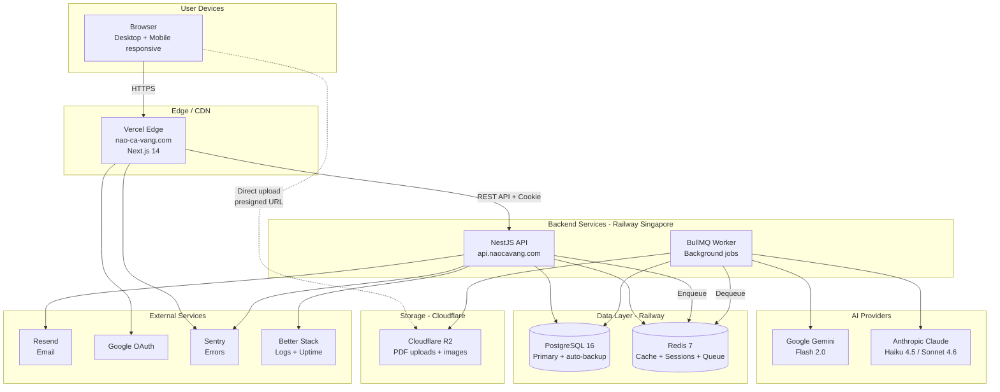

# 🏗️ TECH DECISION — Não Cá Vàng

**Date:** 2026-05-16
**Decided by:** Tech Lead agent (proxy Quân Nguyễn)
**Status:** ✅ APPROVED — Ready for Sprint 1
**Based on:** BRD-v1.0, SRS-v1.0, Project Charter

---

## 1. Tech Stack Được Chọn

| Layer | Technology | Version | Rationale (1 dòng) |
|-------|-----------|---------|--------------------|
| **Frontend** | Next.js (App Router) | 14.x | SSR/RSC tốt cho SEO landing + React rich ecosystem |
| **UI Components** | shadcn/ui + Tailwind | latest | Đẹp out-of-box, customizable, Quân quen Tailwind |
| **Mind Map Editor** | React Flow (xyflow) | 12.x | Mature, hierarchical layout sẵn, performance OK đến 1000 node |
| **Backend** | NestJS | 10.x | TypeScript native, DI built-in, enforce Clean Architecture |
| **Runtime** | Node.js | 20 LTS | Stable, perf tốt cho I/O bound |
| **Database** | PostgreSQL | 16.x | Relational + JSONB cho mind map = best of both worlds |
| **Cache + Queue** | Redis | 7.x | Session + cache + BullMQ queue trong 1 instance |
| **ORM** | Prisma | 5.x | Type-safe, migration tốt, Quân quen |
| **Job Queue** | BullMQ | 5.x | Background AI gen, không block API |
| **Auth** | NextAuth.js (Auth.js) | 5.x | Google OAuth + email/password 1 lib, JWT strategy |
| **Test runner** | Vitest + Playwright | latest | Vitest nhanh hơn Jest, Playwright cho E2E |
| **Linter / Formatter** | Biome | latest | Faster than ESLint + Prettier, single tool |
| **Hosting FE** | Vercel | Hobby tier | Auto-deploy Next.js, CDN tốt, có VN edge |
| **Hosting BE+DB+Redis** | Railway | $5-20/tháng | Setup nhanh, Singapore region (gần VN), auto-scale |
| **Object Storage** | Cloudflare R2 | Free 10GB | $0 egress (vs S3), giảm cost serve image |
| **Email** | Resend | Free 3k/tháng | Modern API, React Email templating, cheap |
| **Error Monitoring** | Sentry | Free 5k events/tháng | Industry standard |
| **Logs + Uptime** | Better Stack | Free tier | Đủ cho MVP |
| **CI/CD** | GitHub Actions | Free 2000 min/tháng | Native với GitHub |
| **Container (local dev)** | Docker Compose | latest | postgres + redis trong 1 file |
| **AI — bulk free tier** | Google Gemini Flash 2.0 | API | $0.075/1M input — rẻ nhất |
| **AI — Premium (v0.2)** | Anthropic Claude Haiku 4.5 | API | Quality cao, có prompt caching |
| **AI — Pro (v0.2)** | Anthropic Claude Sonnet 4.6 | API | Top quality cho task khó |
| **Payment (v0.2)** | VNPay → MoMo → ZaloPay | API | VNPay docs tốt nhất, deploy trước |
| **i18n** | next-intl | latest | VI primary, structure sẵn EN |
| **Monorepo** | Turborepo | latest | Fast incremental builds |
| **Package manager** | pnpm | 9.x | Disk efficient, fast |

---

## 2. Các Phương án Đã Cân nhắc

### 2.1 Backend Framework

| Tiêu chí | NestJS ✅ | FastAPI | Hono + tRPC |
|---------|----------|---------|-------------|
| TypeScript native | ✅ | ❌ Python | ✅ |
| DI built-in | ✅ | Manual | Manual |
| Clean Architecture enforce | ✅ | Manual | Manual |
| Performance | ⭐⭐⭐ | ⭐⭐⭐⭐ | ⭐⭐⭐⭐⭐ |
| Team quen | ✅ | Phải học | Phải học |
| Ecosystem | Rất giàu | Giàu | Đang lớn |
| Decision | **✅ CHỌN** | ❌ | ❌ |

**Lý do chọn NestJS:** TypeScript end-to-end với FE, DI giúp dev nhanh + testable, Clean Architecture / DDD pattern enforce sẵn. Performance Node OK cho 1000 user đầu — sau scale có thể xem xét migrate.

### 2.2 Database

| Tiêu chí | PostgreSQL + JSONB ✅ | MongoDB | Neo4j (graph) |
|---------|---------------------|---------|---------------|
| Mind map tree storage | ✅ JSONB linh hoạt | ✅ Document | ✅ Native graph |
| Relational queries (user, deck, ...) | ✅ | Manual ref | ❌ |
| Transactions | ✅ ACID | Limited | ✅ |
| Hosting cost | Cheap | Trung bình | Đắt |
| Ecosystem (Prisma) | ✅ Best support | Có | Hạn chế |
| Decision | **✅ CHỌN** | ❌ | ❌ |

**Lý do chọn PostgreSQL:** Cần cả relational (user/billing/quota) và document-like (mind map JSON). PostgreSQL JSONB giải quyết cả 2 trong 1 DB. Neo4j over-kill cho mind map đơn giản (chỉ tree, không phải graph thực sự).

> ⚠️ **Risk:** Nếu sau cần real-time collab (v0.2/v1.0) → cần CRDT (Yjs) trong app layer, vẫn lưu PG. Không cần graph DB. Xem [V-202](../../VERIFY_LATER.md#v-202).

### 2.3 Mind Map Editor Library

| Tiêu chí | React Flow ✅ | tldraw | Custom Canvas |
|---------|--------------|--------|---------------|
| Hierarchical layout | ✅ + dagre | Manual | Manual |
| Customizable nodes | ✅ React component | ✅ | ✅ |
| Performance 1000 node | OK | Tốt | Tốt nhất |
| Learning curve | Medium | Medium | High |
| MIT license | ✅ | ✅ Apache | N/A |
| Community | Lớn | Lớn | N/A |
| Decision | **✅ CHỌN** | ❌ | ❌ |

**Lý do chọn React Flow:** Hierarchical layout built-in, plugin dagre auto-layout, dễ render React component trong node (để add image, icon, formatting). Tldraw mạnh cho free-form drawing nhưng mind map cần hierarchy strict. Custom canvas — over-engineering cho MVP.

### 2.4 Hosting

| Tiêu chí | Vercel + Railway ✅ | Render + Render | AWS Amplify + RDS | Self-hosted VPS |
|---------|--------------------|-----------------| ------------------|-----------------|
| Setup time | < 1 giờ | < 2 giờ | 1 ngày | 1-2 ngày |
| Cost MVP (1k user) | $0-25/tháng | $10-30 | $50+ | $5-10 |
| Auto-scale | ✅ | ✅ | ✅ | ❌ Manual |
| VN region | Edge VN (CF) | Singapore | Singapore | Tùy VPS |
| DB managed | ✅ Railway PG | ✅ Render PG | ✅ RDS | Manual |
| Decision | **✅ CHỌN** | Alt | Defer | Defer |

**Lý do chọn Vercel + Railway:**
- Vercel: Next.js native, deploy 1 push, edge CDN gần VN
- Railway: PostgreSQL + Redis + NestJS API trong 1 platform, Singapore region (~50ms latency VN), $5 base + usage

> ⚠️ **Watch:** Set budget alert $50/tháng. Khi vượt → review migrate sang VPS cheaper. Xem [V-303](../../VERIFY_LATER.md#v-303).

### 2.5 AI Provider

| Model | Cost (input/output per 1M token) | Quality (mind map gen) | Latency | Use case |
|-------|----------------------------------|------------------------|---------|----------|
| **Gemini Flash 2.0** | $0.075 / $0.30 | ⭐⭐⭐⭐ | ~3-5s | **Free tier (mặc định)** |
| Claude Haiku 4.5 | ~$0.80 / $4.00 | ⭐⭐⭐⭐⭐ | ~3-8s | **Premium (v0.2)** |
| Claude Sonnet 4.6 | ~$3 / $15 | ⭐⭐⭐⭐⭐ | ~5-12s | **Pro (v0.2)** |
| GPT-4o-mini | $0.15 / $0.60 | ⭐⭐⭐⭐ | ~3-7s | Backup option |
| Llama 3 self-hosted | $0 token, $50+/tháng GPU | ⭐⭐⭐ | varies | Tương lai khi scale |

**Strategy multi-AI (xem ADR-005):**
- Centralized `AiRoutingService` chọn model based on user tier + task type
- Gemini Flash mặc định free tier
- Claude Haiku/Sonnet tier paid với prompt caching để giảm 90% cost
- Track cost mỗi request vào `ai_usage_log`

---

## 3. Kiến trúc Hệ thống

---

## 4. Module Breakdown

| Module | Sprint | Priority | LOC est | Owner |
|--------|--------|----------|---------|-------|
| `auth` | 1 | P0 | ~800 | Sr Dev agent |
| `user` | 1 | P0 | ~500 | Sr Dev agent |
| `mindmap` (CRUD + editor) | 2 | P0 | ~1500 | Sr Dev agent |
| `template` | 2 | P1 | ~600 | Sr Dev agent |
| `ai` (routing + workers) | 3 | P0 | ~1200 | Sr Dev agent |
| `flashcard` (gen + SR) | 3-4 | P0 | ~1000 | Sr Dev agent |
| `quiz` | 4 | P0 | ~800 | Sr Dev agent |
| `shared` (errors, logging, util) | 1 (continuous) | P0 | ~500 | Sr Dev agent |
| `infrastructure` (DB, cache, R2, email) | 1 | P0 | ~600 | DevOps agent |
| `billing` | 6+ (v0.2) | — | — | Defer |

---

## 5. Implementation Plan (Sprint by Sprint)

### Sprint 1: Foundation (T1-T2, 16/05 → 30/05/2026)

**Goal:** Repo setup, auth working, deploy staging.

- [ ] Monorepo setup (pnpm + Turborepo) — `apps/web`, `apps/api`, `packages/shared-types`
- [ ] Docker Compose: postgres 16 + redis 7
- [ ] NestJS API skeleton + Prisma schema initial (User, Session) + first migration
- [ ] Next.js 14 skeleton + Tailwind + shadcn/ui setup
- [ ] NextAuth.js (Google + Email/Password) — FR-001, FR-003
- [ ] Onboarding wizard — FR-002
- [ ] GitHub Actions CI: lint + typecheck + test
- [ ] Deploy staging: Vercel (FE) + Railway (BE + DB + Redis)
- [ ] Sentry + Better Stack setup
- [ ] Observability setup theo runbook
- [ ] **POC mind map render** (React Flow + 500/1000 node) — verify [V-202](../../VERIFY_LATER.md#v-202), [V-304](../../VERIFY_LATER.md#v-304)

**Sprint 1 Demo:** Đăng nhập Google, hoàn thành onboarding, thấy dashboard rỗng.

### Sprint 2: Mind Map Editor + Template (T3-T4, 30/05 → 13/06)

- [ ] Prisma schema: MindMap + Template
- [ ] API CRUD `/mindmaps` (GET list, POST create, GET id, PATCH, DELETE)
- [ ] FE: Mind map editor với React Flow — FR-010
  - Drag-drop, add/delete node, color picker, icon
  - Auto-save 500ms debounce — FR-011
- [ ] FE: Embed image (upload R2 presigned URL) — FR-012
- [ ] API CRUD `/templates`
- [ ] Template seed script: 50+ template (AI generate + curate) — FR-061
- [ ] FE: `/templates` page với filter — FR-060
- [ ] Unit + integration tests

**Sprint 2 Demo:** Tạo mind map từ template, edit, save, mở lại.

### Sprint 3: AI Mind Map + Flashcard (T5-T6, 13/06 → 27/06)

- [ ] Cloudflare R2 setup, BE generate presigned URL
- [ ] BullMQ worker setup
- [ ] PDF parsing (pdf-parse) + chunking
- [ ] `AiRoutingService` + Gemini Flash integration — FR-021, ADR-005
- [ ] `MindmapFromPdfJob` worker — FR-020
- [ ] FE: Upload PDF + progress UI + polling
- [ ] AI usage tracking — `ai_usage_log` table
- [ ] Quota enforcement middleware
- [ ] Flashcard module: deck + cards CRUD — FR-030
- [ ] AI gen flashcard từ mind map — FR-030
- [ ] Manual AI quality eval (20 PDF samples)
- [ ] **VERIFY V-205** (quota 50/tháng đủ không) sau real testing

**Sprint 3 Demo:** Upload PDF Hóa 12 → ra mind map → tạo 50 flashcard.

### Sprint 4: Spaced Repetition + Quiz (T7, 27/06 → 04/07)

- [ ] SM-2 algorithm implementation — FR-040
- [ ] Cron job daily reminder — FR-041
- [ ] FE: Flashcard review UI (full screen, swipe gestures) — FR-031
- [ ] Quiz module: AI gen quiz từ mind map — FR-050
- [ ] FE: Quiz play + chấm điểm — FR-051
- [ ] E2E tests Playwright (top 10 paths)
- [ ] Performance testing k6 (200 concurrent)
- [ ] Alpha bug fix

**Sprint 4 Demo (30/06):** Alpha demo nội bộ 5-10 user.

### Sprint 5: Polish + Production Launch (T8, 04/07 → 15/07)

- [ ] Fix alpha bug
- [ ] WCAG accessibility pass
- [ ] Onboarding tooltip + 2-min video demo
- [ ] Privacy Policy + Terms of Service
- [ ] DNS setup: naocavang.com + naocavang.vn
- [ ] Production deploy + smoke test theo `deployment-pipeline` runbook
- [ ] `production-readiness-audit` runbook checklist
- [ ] **🚀 LAUNCH 15/07/2026**

**Sprint 5 Demo:** Public launch live.

---

## 6. Rủi ro Kỹ thuật

| # | Rủi ro | Xác suất | Impact | Mitigation |
|---|--------|----------|--------|------------|
| TR1 | React Flow performance kém với 1000+ node | TB | HIGH | POC Sprint 1, virtualization nếu cần |
| TR2 | AI quality kém → user churn | TB | HIGH | Manual eval Sprint 3, A/B prompt, fallback "draft only" |
| TR3 | Cost AI vượt budget | TB | HIGH | Cache, quota free 50/tháng, alert $20/ngày |
| TR4 | Railway pricing tăng khi scale | LOW | TB | Monitor, plan migrate VPS khi $100+/tháng |
| TR5 | OAuth Google rate limit | LOW | LOW | Backup email login |
| TR6 | PDF parsing fail (scan-image PDF) | TB | TB | Detect → message rõ ràng, v0.2 thêm OCR |
| TR7 | Monorepo build chậm | LOW | LOW | Turborepo cache |
| TR8 | Prisma migration conflict khi multi env | TB | TB | Migration trong CI, không manual deploy |

---

## 7. Cost Estimate (MVP launch — 100 user)

| Item | Monthly cost | Notes |
|------|-------------|-------|
| Vercel Hobby | $0 | Đủ cho 100k req/tháng |
| Railway BE + DB + Redis | $10-15 | $5 base + usage |
| Cloudflare R2 | $0 | Free 10GB |
| Resend email | $0 | Free 3k email/tháng |
| Sentry | $0 | Free 5k events |
| Better Stack | $0 | Free tier |
| AI (Gemini Flash) | $5-20 | 1000 gen/tháng * ~$0.005 |
| Domain | $0.83 ($10/năm) | naocavang.com |
| **Total MVP** | **$15-35/tháng** | Trong budget $50 |

### Scale 1000 user (3 tháng sau launch)
- Vercel: $0-20
- Railway: $30-50
- AI: $30-80 (5000 gen/tháng)
- Email: $0 hoặc $20
- **Total:** **$60-170/tháng** — vẫn ổn

### Scale 10000 user (6 tháng)
- **Total:** **$200-500/tháng** — cần Premium revenue cover

---

## 8. ADR Index

| # | Title | File |
|---|-------|------|
| ADR-001 | Tech stack chính | [docs/adr/001-tech-stack.md](../adr/001-tech-stack.md) |
| ADR-002 | Mind map storage: PostgreSQL JSONB | [docs/adr/002-mindmap-storage.md](../adr/002-mindmap-storage.md) |
| ADR-003 | Monorepo với Turborepo + pnpm | [docs/adr/003-monorepo-structure.md](../adr/003-monorepo-structure.md) |
| ADR-004 | Spaced Repetition algorithm: SM-2 | [docs/adr/004-spaced-repetition-sm2.md](../adr/004-spaced-repetition-sm2.md) |
| ADR-005 | Multi-AI provider strategy | [docs/adr/005-multi-ai-provider.md](../adr/005-multi-ai-provider.md) |

---

## 9. Tech Lead Sign-off

✅ **Tech Decision approved** — Sprint 1 kickoff ready.

### Bước tiếp theo:
1. ✅ Cập nhật `CLAUDE.md` với tech stack vừa chọn
2. ✅ Tạo 5 ADR
3. ✅ Tạo `IMPLEMENTATION_PLAN.md` chi tiết
4. ▶️ Gọi `/senior-developer` skill để Sprint 1 kickoff

---

**Tech Lead:** AI agent (proxy Quân Nguyễn)
**Date:** 2026-05-16
